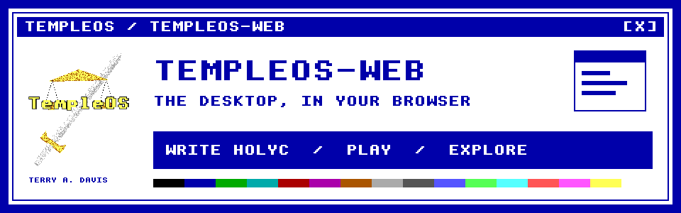

<p align="center">
  
</p>

# TempleOS-Web

**TempleOS in your browser.** Write HolyC, play games, and explore Terry A. Davis's operating system.

**[Open TempleOS →](https://templeosweb.netlify.app/)**

---

<details>
<summary><b>Using the desktop</b></summary>

<br>

Click the screen to send keyboard and mouse input. Press **Esc** to release the mouse; use the **Keys** window to send Escape to a game.

- **Games** opens the catalog. Run a game in the browser or inside TempleOS, or edit its source.
- **HolyC Editor** lets you write, format and run HolyC.
- **Disk & Save** imports files, exports C: or saves the whole running machine.
- **Restart** returns to the stock desktop and preserves your saved C: drive.

C: changes save automatically in this browser's IndexedDB. Clearing site data removes them; export a disk image for a separate backup. Phones have touch controls and an on-screen key bar.

[Desktop guide](Doc/Guide.md#try-it) · [Games and authors](Demo/Games/README.md)

</details>

---

<details>
<summary><b>How it works</b></summary>

<br>

The desktop runs the real TempleOS V5.03 kernel and HolyC compiler. [HEMU](https://github.com/ParkerrDev/HEMU) resumes a prepared machine capture with the Welcome card and Take Tour question already open.

HEMU's CPU and devices are written in HolyC and compiled to WebAssembly by [HolyC-wasm](https://github.com/ParkerrDev/HolyC-wasm). JavaScript connects the machine to browser workers, storage, sound and input. Games launched with **Run in Browser** compile directly to WASM; **Run in TempleOS** uses the emulated machine.

This resumes a captured desktop; it does not boot the DVD's BIOS loader. Compatibility and game checks have specific limits.

[Runtime and loading](Doc/Guide.md#how-it-works) · [Game compatibility](Demo/Games/Compatibility.json)

</details>

---

<details>
<summary><b>Build and contribute</b></summary>

<br>

Use Node.js 22.19 or later. From a fresh checkout:

```sh
while read dir url sha; do git clone -q "$url" "$dir" && git -C "$dir" checkout -q "$sha"; done <Siblings.txt
while read dir url sha; do git clone -q "$url" "hemu/$dir" && git -C "hemu/$dir" checkout -q "$sha"; done <hemu/Siblings.txt
npm ci
npm run build
npm test
npm run serve
```

Open **http://localhost:8080**. The server sets the isolation headers needed by shared memory.

[Build, hosting and repository layout](Doc/Guide.md) · [Report a bug or suggest a game](https://github.com/ParkerrDev/TempleOS-Web/issues)

</details>

---

<details>
<summary><b>Credits and related projects</b></summary>

<br>

TempleOS, HolyC, the sword-and-scales artwork and the 8×8 system font were created by **Terry A. Davis**. TempleOS is public domain. The banner uses its font and artwork.

[HEMU](https://github.com/ParkerrDev/HEMU) · [HolyC-wasm](https://github.com/ParkerrDev/HolyC-wasm) · [HolyC-fmt](https://github.com/ParkerrDev/HolyC-fmt) · [HolyCraft](https://github.com/ParkerrDev/HolyCraft) power the machine, compiler, formatter and voxel game.

[afterdavis](https://github.com/ParkerrDev/afterdavis), the [archive transcriber](https://github.com/ParkerrDev/TerryADavis-archive-transcriber) and [omarchy-templeos](https://github.com/ParkerrDev/omarchy-templeos) cover the text adventure, searchable archive and Linux theme.

[Full credits and third-party licenses](Doc/Guide.md#credits--licenses)

</details>
