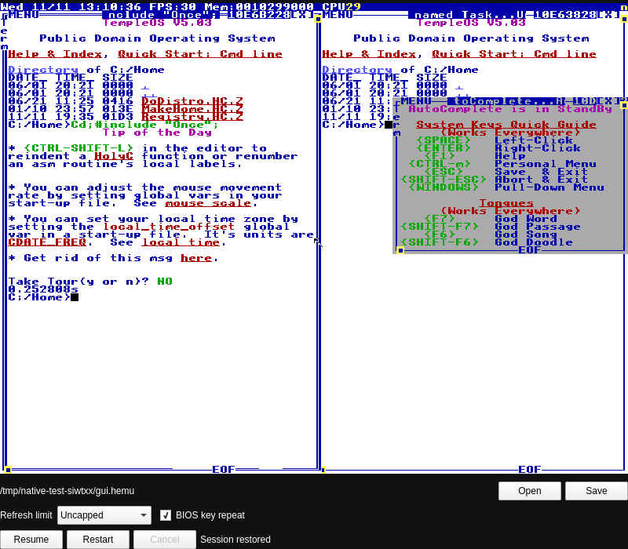

# Native HEMU host



This host runs the HolyC-generated HEMU WASM and its existing x86-to-WASM block
JIT in JavaScriptCore, with Qt Quick for the window and zlib for snapshots.
There is no DOM, Chromium, Electron or Node runtime. Node and the pinned
**esbuild 0.28.2** are build tools only.

This is an in-progress Linux x86-64 host. One guest CPU is supported; four-core
and shared-ownership snapshots are rejected before WASM instantiation. The
macOS JavaScriptCore framework build branch is untested. Other host CPU/OS
combinations and native-host performance are not qualified.

From the repository root, with the pinned compiler and HEMU sources present:

```sh
npm ci
node engine/build.mjs
node tools/native/build.mjs
node tools/native/fixture.mjs
build/native/hemu-native build/native/TempleOS.hemu
```

For a local Arch package, build a separate running, uncapped default capture:

```sh
node tools/native/fixture.mjs build/native/TempleOS-default.hemu --rate 0 --running
node tools/native/build.mjs
node tools/native/package.mjs --build
node tools/native/pointer/build.mjs
node tools/native/package.test.mjs
```

The package and its source archive are under `build/native/package`. The package
pins the locally qualified Qt and JavaScriptCore package versions because of the
private boundaries described below; rebuild and requalify after upgrading them.
It includes a desktop launcher, `.hemu` file association and a complete one-core
snapshot. No Node or Chromium runtime is installed. The source archive contains
the generated JS bundle, its exact input hashes, generated protocol bindings,
C++/QML sources and snapshot provenance. `makepkg` compiles the native binary and
validates the complete saved machine before packaging. This is a local preview;
it is not a published distribution.

Install the resulting package using the system package manager to add the launcher.
Without a command-line path, the app finds `hemu-native/TempleOS.hemu` through
Qt's standard data locations. Supplying a path opens that saved session instead.
Save always chooses a writable destination through the portal; it never silently
overwrites the packaged capture. The package test extracts into a temporary root,
validates its CLI/MIME/desktop metadata, and observes the actual packaged GUI's
TempleOS frame on a private Wayland compositor. Its startup time is one observation
under the recorded host load, not a stable performance guarantee.

The bundle can be rebuilt separately with
`node tools/native/build.mjs --bundle-only`. Its exact input hashes and output
SHA-256 are written to `build/native/Runtime.json`; `Build.json` records the
C++/QML source hashes, binary hash and local Qt/JSC versions. Qt's resource compiler
embeds the bundle in the binary; no generated code is committed. The platform
build needs Qt 6 Core/Gui/Qml/Quick/Multimedia/DBus, qmake6, a C++17 compiler, zlib and
JavaScriptCoreGTK 4.1 development headers/libraries. Linux pointer capture needs
Qt 6.12 or later with its matching private GUI headers, wayland-client,
wayland-protocols and wayland-scanner. Protocol bindings are generated from the
installed XML; `Build.json` records their hashes and dependency versions. The
test build also needs Qt Test and Qt WaylandCompositor. Tested locally with
Qt 6.12.0, JavaScriptCoreGTK 2.54.1, Wayland 1.26.0 and protocols 1.49.

The fixture command uses the real one-core worker, validates its stock
RAM/register/disk pairing, waits for the document sprite correction, and
exports a complete paused session. It adds no Welcome popup. You can also open
a complete one-core `.hemu` file exported by the web version. Raw RAM files
lack sufficient CPU and disk state and are refused. This host resumes captured
TempleOS; it does not implement a cold BIOS/DVD boot.

The window accepts a session path, Open, Save, Pause/Resume, Restart and Cancel.
Refresh limit offers Uncapped, 30, 60 and 120 through the same guest WinRateSet
implementation as the browser. BIOS key repeat uses the emulated keyboard's
guest-programmed typematic delay/rate; Qt autorepeat is not injected. Imported
settings are displayed without changing the saved machine, and subsequent saves
preserve explicit choices. An unknown guest timing layout reports failure instead
of claiming the requested limit was applied. Changing these settings is serialized
on the machine thread and releases held input.
Click the screen to route keys to TempleOS. Moving focus away releases held
keys. The [Qt Wayland input source](https://codebrowser.dev/qt6/qtbase/src/plugins/platforms/wayland/qwaylandinputdevice.cpp.html#1342)
provides the eight-key XKB offset used here. Linux evdev/XKB scan codes preserve left/right modifiers and keypad
identity; the logical Qt-key fallback has not been qualified on macOS.

When a running guest hides its pointer for a game, click the screen to request
relative capture. **Ctrl+Alt releases it.** Focus loss, pause, saving, session
replacement and retained CPU faults release the compositor lock and held input.
Capture is a host lease: restoring a saved session never acquires it automatically.
The Linux adapter uses Wayland pointer-constraints and relative-pointer version1,
waits for the compositor's grant, and delivers fractional unaccelerated deltas.
It does not claim raw hardware motion. A refused request times out with a retry
message; unsupported compositors and X11 retain absolute input with an explicit
capture diagnostic. macOS relative input remains unimplemented.

Qt's public Wayland interface provides the connection and pointer; its private
QPA boundary supplies only the window's `wl_surface`. The registry, managers and lock objects use Qt's default queue: its Wayland
reader wakes the GUI thread to dispatch their callbacks. There is no periodic
pointer poll while active or idle; only an outstanding capture request starts
a bounded refusal timer. Registry removal and reannouncement remain event driven.
The [Qt dispatch source](https://codebrowser.dev/qt6/qtbase/src/plugins/platforms/wayland/qwaylanddisplay.cpp.html#529)
shows the default queue's `EmitToDispatch`/queued `flushRequests` boundary. Capture is
refused if the runtime Qt version differs from the build headers; rebuild after
upgrading Qt. This private boundary is confined to `Pointer.cpp`.

Paused and faulted machines stop the worker tick timer; resume explicitly restarts
it with a fresh clock origin so paused time is not credited to the guest. Save
and replacement retain the running/paused choice in the saved session.
Running clock deltas are retained across the guest's 100 ms step limit; one
bounded batch runs per Qt tick until a stall's backlog is credited. Pausing,
saving and faults discard only uncredited host backlog. That ephemeral pacing
state is not part of the saved CPU clock, and time spent paused or saving is
not added on resume.

New HEMU modules emit speaker frequency and unsigned TSC nanoseconds through
`__host_snd(F64,U64)`. The native host keeps ordered transitions, including
silence, until the guest's end-of-batch clock watermark. A bounded 48 kHz mono
PCM queue renders those intervals on the machine thread; Qt consumes it on
its audio thread. The queue holds at most 500 ms and starts after 40 ms of
prefill. Underruns output silence and refill; overflow or invalid time order
clears stale samples and reports an audio diagnostic. Pause, save, replacement
and faults flush both the PCM queue and Qt's device buffer. Audio buffering is
ephemeral and is not serialized as guest state.

Older embedded engines retain their one-argument `__snd` import. They still
play tones, but provide no timestamps; the host does not invent timing for
them. New modules need the matching host import and fail during instantiation
on an older host. This is a host-import change, not a CPU/RAM or snapshot-file
layout change. Timestamped playback is qualified for one guest CPU only. The
shared clock and speaker state still lack a total cross-core event order, and
the frequency-only PIT model does not reproduce hardware counter phase or
odd-divisor duty cycles.

Loading and saving run on the dedicated JSC thread. A replacement uses a fresh
JSC context, keeping its JIT state separate from the previous machine. Only a
fully validated candidate publishes its frame. Failed or cancelled loads leave
the previous machine paused and available. Native output uses bounded chunks
and QSaveFile atomic replacement; failure or cancellation preserves the old
file. During replacement, both old and candidate memory can coexist. This is
not a low-memory peak claim.

Open and Save use the desktop's [FileChooser portal](https://flatpak.github.io/xdg-desktop-portal/docs/doc-org.freedesktop.portal.FileChooser.html)
over session D-Bus. Save chooses a destination and makes a successful save the
current restart path. Cancel closes only that request; late responses cannot
replace a newer selection. Only one local file is accepted. A missing or exited
portal leaves the existing session available with a visible diagnostic. This
requires the standard token-based request handles introduced in portal 0.9.

The snapshot framing, SHA-256 engine validation, heap ABI and restore logic are
shared with the web host. Native zlib and browser CompressionStream are
transport adapters. Existing version 1 saves remain readable. The CPU, heap
and snapshot file layouts are unchanged. A saved document correction retains
its original patch policy; the native host does not fetch or inject a new one
while restoring.

```sh
build/native/hemu-native check build/native/TempleOS.hemu
build/native/hemu-native check build/native/TempleOS.hemu 60
HEMU_NATIVE_FIXTURE="$PWD/build/native/TempleOS.hemu" node tools/native/test.mjs
HEMU_NATIVE_FIXTURE="$PWD/build/native/TempleOS.hemu" node tools/native/format.mjs
node tools/native/check.mjs --web
```

`check` emits JSON, returns 0 on success and reports failures on stderr. Without
a tick count it validates/restores without running the guest. Tests exercise
forced cancellation at actual read/write boundaries, atomic file preservation,
exact paused RGBA restoration, guest file round trips, native keyboard state,
retained CPU faults and the actual Qt window. The default screenshot path is
`/tmp/hemu-native-window.png`; override with `HEMU_NATIVE_SCREENSHOT`.

The Linux check also starts a private Qt Wayland compositor and real clients.
It verifies grant/refusal/timeout, fractional motion, Ctrl+Alt, focus and surface
lifetime, plus the production QML/Backend against HEMU. A native guest task must
observe the expected relative coordinates; tests also save/reopen, reject a bad
replacement and execute a real retained CPU fault while captured. These use an
isolated compositor and do not send input to the user's desktop.

The file chooser tests use a separate private D-Bus session and service to force
response-before-reply, cancellation/successor ordering, service exit and bad URI
cases. The production QML/Backend test opens and saves a complete machine through
that protocol, and checks replacement confirmation and the new restart path.
They do not open a dialog on the user's desktop.

The Linux audio check additionally needs PipeWire, its PulseAudio protocol
module, WirePlumber, `pactl` and `parec`. It creates a private server, policy
session and virtual sink; it never routes audio to the user's hardware. The
actual Qt output must preserve 420 ordered 140 Hz tone/silence transitions
across 144,000 exact PCM samples. A separate native guest task verifies both
PIT pitches in 140 tone/silence groups, and the production Backend is recorded
through pause, save/restore, replacement failure and retained CPU faults.
These are bounded idle-host tests, not an assertion that a loaded game always
meets its speaker task deadline. Evidence is saved under
`build/native/evidence/audio` (override with `HEMU_NATIVE_AUDIO_EVIDENCE`).

Remaining qualification includes system-wide installation, loaded-game audio
cadence, performance/resource measurement, and non-Linux platforms. The
browser host's four-core protocol remains separate; this window does not yet
satisfy that native SMP requirement.

JavaScriptCoreGTK initialization is a platform boundary: its C API does not
initialize the WebKit main run loop used by the deferred full-GC callback in
the tested 2.54.1 library. `JsInit.hpp` initializes that loop on Qt's application
thread before any engine workers, through the library's exported **private**
`WTF::initializeMainThread` function. This is not a stable public JSC ABI. The
host refuses a header/runtime JSC version mismatch and must be rebuilt and
qualified when that dependency changes. GC remains enabled. The macOS branch
does not use this Linux compatibility adapter and remains unqualified.

The pre-fix host reproduced a null-main-loop crash during a real
open/resume/save/pause/resume lifecycle. The 45-second lifecycle regression now
also replaces the machine; `node tools/native/lifecycle.mjs --gc-proof` uses GDB
to require actual deferred full-GC callbacks before it passes. The ordinary
native check includes the lifecycle without the debugger. This bounds the
regression evidence; it does not establish indefinite runtime stability.
See the source-derived [GC failure evidence](../../tools/native/DeferredGc.md).
